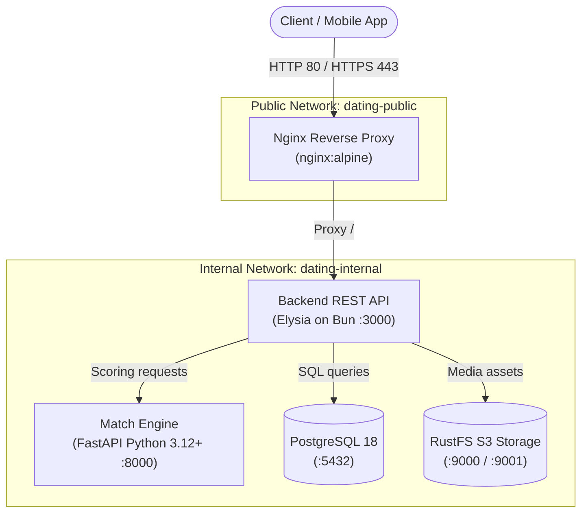

# dating-infra

> **Online Dating System (SEN-201)**  
> **Team:** Mai Ru (`Mai-Ru-Software-House`)  
> **Repository:** [dating-infra](https://github.com/Mai-Ru-Software-House/dating-infra)

Centralized Docker container orchestration, network routing, and local/production infrastructure for the Online Dating System microservices suite.

---

## Table of Contents

- [System Architecture](#system-architecture)
- [Repository Structure](#repository-structure)
- [Prerequisites](#prerequisites)
- [Configuration & Secret Management](#configuration--secret-management)
- [Environments](#environments)
  - [Development Environment](#development-environment)
  - [Production Environment](#production-environment)
  - [Releasing](#releasing)
  - [Deploying to the demo host](#deploying-to-the-demo-host)
- [Service Registry & Port Mappings](#service-registry--port-mappings)

---

## System Architecture

The infrastructure orchestrates five containerized services across two Docker bridge networks (`dating-public` and `dating-internal`) to enforce security boundaries and network isolation:



### Components

| Service | Technology | Role |
|---|---|---|
| **Nginx** | `nginx:alpine` | Gateway reverse proxy, SSL termination, and static/header management |
| **API** | TypeScript / Elysia on Bun | Core REST API, user profiles, chat messages, and business logic |
| **Match Engine** | Python 3.12+ / FastAPI | High-performance candidate ranking and score computation |
| **PostgreSQL** | `postgres:18` | Primary relational database for user records, swipes, and chats |
| **RustFS** | `rustfs/rustfs:1.0.4` (pinned in production) | S3-compatible high-performance object storage for photos and media |
| **Watchtower** | `containrrr/watchtower` | Automated container updater for pulling updated images and restarting services (Dev only) |

---

## Repository Structure

```text
dating-infra/
├── .env.example                # Environment variable template (committed, no secrets)
├── .gitattributes              # Keeps LF line endings on scripts and nginx files
├── .gitignore                  # Protects secrets (.env), OS artifacts, and certs
├── README.md                   # Project and infrastructure documentation
├── docker-compose.dev.yaml     # Compose configuration for local development
├── docker-compose.prod.yaml    # Compose configuration for production deployments
├── docs/
│   └── APP-GUIDE.md            # Installing and using the mobile app
├── nginx/
│   ├── api-proxy.inc           # Routes shared by the production server blocks
│   ├── certs/                  # TLS certificates (ignored by git)
│   │   └── .gitkeep
│   ├── nginx.dev.conf          # Nginx configuration for development
│   ├── nginx.prod.conf         # Production with HTTPS: 443 serves the API, 80 redirects
│   └── nginx.prod.http.conf    # Production without HTTPS: plain HTTP on 80
├── scripts/                    # Production install, upgrade, backup, uninstall, smoke test
│   ├── lib.sh, lib.ps1         # Shared helpers
│   └── *.sh, *.ps1             # Bash (Linux, macOS) and PowerShell (Windows) versions
└── .github/workflows/
    ├── kics.yml                # KICS, compose check, ShellCheck, dev stack smoke test
    └── release.yml             # Builds the server kit on a vX.Y.Z tag
```

---

## Prerequisites

Ensure you have the following installed on your host system:

- [Docker Engine](https://docs.docker.com/engine/install/) (v24.0+)
- [Docker Compose](https://docs.docker.com/compose/) (v2.20+)
- A 64-bit x86 (x86_64) host. arm64 hosts, including Apple Silicon Macs, are not supported by the production images.
- Network access to the GitHub Container Registry (`ghcr.io/mai-ru-software-house`)

If the service images are private, authenticate with the GitHub Container Registry before pulling:

```bash
echo $CR_PAT | docker login ghcr.io -u YOUR_GITHUB_USERNAME --password-stdin
```

---

## Configuration & Secret Management

In accordance with **Mai Ru Coding Standards (Rule 4)**:
> *Never commit secrets. Read them from environment variables; commit a `.env.example` with dummy values only.*

### 1. Create Local `.env`

Copy the provided template to create your untracked `.env` file:

```bash
cp .env.example .env
```

### 2. Environment Variables Specification

| Variable | Description | Example / Default |
|---|---|---|
| `POSTGRES_PASSWORD` | Password for PostgreSQL user `app` | `your_secure_password` |
| `RUSTFS_ACCESS_KEY` | Access key for S3 RustFS storage | `32-character-hex-string` |
| `RUSTFS_SECRET_KEY` | Secret key for S3 RustFS storage | `32-character-hex-string` |
| `BACKEND_IMAGE` | Docker image for backend API service. Release tag (`:1.0.0`) in production, `:dev` in development | `ghcr.io/mai-ru-software-house/dating-backend:1.0.0` |
| `MATCH_ENGINE_IMAGE`| Docker image for Match Engine service. Release tag in production, `:dev` in development | `ghcr.io/mai-ru-software-house/dating-match-engine:1.0.0` |
| `MATCH_ENGINE_URL`  | Internal Match Engine URL for API service | `http://match-engine:8000` |
| `BACKEND_URL`       | Internal Backend API URL for Match Engine | `http://api:3000` |
| `ARGON2_MEMORY_COST`| Argon2 memory cost parameter in KiB | `65536` (64 MiB) |
| `ARGON2_TIME_COST`  | Argon2 iteration / time cost parameter | `3` |
| `ARGON2_PARALLELISM`| Argon2 threads / degree of parallelism | `4` |
| `JWT_SECRET` | Secret used to sign login tokens. Required, no default. Generate one with `openssl rand -hex 32` | `your_long_random_jwt_secret_here` |
| `CORS_ORIGINS` | Comma separated list of origins allowed by CORS |  |
| `RUSTFS_BUCKET` | RustFS bucket for profile photos. The backend creates it when it starts | `mairu-photos` |
| `WATCHTOWER_POLL_INTERVAL`| Polling interval (seconds) for auto-updating dev images (development only) | `30` |
| `NGINX_CONF` | Production only, set by `scripts/install`. Nginx config to mount: `./nginx/nginx.prod.conf` (HTTPS) or `./nginx/nginx.prod.http.conf` (plain HTTP) | `./nginx/nginx.prod.http.conf` |

`JWT_SECRET` has no default on purpose. The `api` container stops at start if it is missing.

#### Optional backend settings

They are in `.env.example` as comments. Both compose files give them the default below, so set one in `.env` only when you need a different value.

| Variable | Description | Default |
|---|---|---|
| `NOMINATIM_URL` | Place name lookup service. The public OpenStreetMap server allows 1 request per second, and the backend limits itself to that | `https://nominatim.openstreetmap.org` |
| `NOMINATIM_EMAIL` | Contact email sent to OpenStreetMap with each lookup | empty |
| `ACCESS_TOKEN_TTL_SECONDS` | Life of a login token, in seconds | `900` |
| `REFRESH_TOKEN_TTL_DAYS` | Life of a refresh token, in days | `30` |
| `MATCH_ENGINE_TIMEOUT_MS` | How long the API waits for the Match Engine, in milliseconds | `5000` |

Both Nginx files set `client_max_body_size 6m;`, so a 5 MB photo upload reaches the backend. The backend itself refuses a request body over 6 MiB.

> [!WARNING]
> Real passwords, API keys, and certificate files must **never** be committed to version control. The `.gitignore` file enforces this exclusion.

---

## Environments

### Development Environment

The development environment mounts ports directly to `localhost` to allow direct database queries, storage inspection, and service debugging.

> [!NOTE]
> `.env.example` carries the release image tags. For development set `BACKEND_IMAGE` and `MATCH_ENGINE_IMAGE` to the `:dev` tags, which Watchtower follows.

#### Start Development Services

```bash
docker compose -f docker-compose.dev.yaml up -d
```

#### Check Service Status

```bash
docker compose -f docker-compose.dev.yaml ps
```

#### Follow Logs

```bash
docker compose -f docker-compose.dev.yaml logs -f
```

#### Automatic Container Updates (Watchtower)

The development compose includes a **Watchtower** service that continuously polls the GitHub Container Registry (GHCR) and automatically recreates running containers whenever a new image is pushed:

- **Targeted Services:** Only services with label `com.centurylinklabs.watchtower.enable=true` (`api` and `match-engine`) are monitored and updated automatically.
- **Polling Interval:** Defaults to 30 seconds (configurable via `WATCHTOWER_POLL_INTERVAL` in `.env`).
- **Cleanup:** Automatically purges superseded, dangling Docker images to preserve host disk space (`WATCHTOWER_CLEANUP=true`).
- **Authentication:** Uses the host Docker credentials mounted from `~/.docker/config.json` (created during `docker login ghcr.io`).

To follow Watchtower auto-update logs:

```bash
docker compose -f docker-compose.dev.yaml logs -f watchtower
```

#### Tear Down Development Environment

```bash
# Stop containers (preserves database and storage volumes)
docker compose -f docker-compose.dev.yaml down

# To reset all database and storage volumes (WARNING: wipes data)
docker compose -f docker-compose.dev.yaml down -v
```

---

### Production Environment

The production configuration isolates backend services (`api`, `match-engine`, `postgres`, `rustfs`) behind Nginx on the private `dating-internal` network. Only ports `80` and `443` on Nginx are bound to the host. Every service has `restart: unless-stopped`, so the stack comes back after a reboot as long as Docker itself starts at boot (`sudo systemctl enable docker` on Linux, "Start Docker Desktop when you sign in" on Windows and macOS). The Compose project is named `mairu`, so volumes are `mairu_postgres-data` and `mairu_rustfs-data` wherever the folder lives.

Production is delivered as the **server kit** `mairu-server-X.Y.Z.zip` (or `.tar.gz`) attached to a GitHub Release of this repository, together with `SHA256SUMS`. It holds the production compose file, the Nginx files, `.env.example`, the scripts below and the documentation in `docs/`. Check the download with `sha256sum -c SHA256SUMS`.

#### Requirements

Docker Engine 24+ with Compose 2.20+ (Docker Desktop with the WSL 2 backend on Windows), a 64-bit x86 CPU, 4 GB of memory for the stack, about 10 GB of free disk, ports 80 and 443 open, and outbound HTTPS to `ghcr.io` and `nominatim.openstreetmap.org`.

#### Scripts

Run them from anywhere; they switch to the kit folder themselves. Linux and macOS use the `.sh` files (bash). On Windows use the `.ps1` files from PowerShell:

```powershell
powershell -ExecutionPolicy Bypass -File scripts\install.ps1 -Address 192.168.1.20
```

If Windows blocks the files that came from a download, run `Get-ChildItem -Recurse | Unblock-File` in the kit folder first.

| Script | What it does |
|---|---|
| `install` | Checks the CPU, Docker and Compose versions. Creates `.env` from `.env.example` with generated secrets (only when it does not exist yet), picks HTTP or HTTPS from the certificate files (see below), pulls the images, runs `up -d --wait` and then the smoke test. Safe to run again; it refuses to create a new `.env` when data volumes from an earlier install exist. Options: `--host <name-or-ip>` (`-Address` on Windows) is the address phones use, for the printed URLs; `--self-signed` (`-SelfSigned`) creates a self-signed certificate |
| `upgrade [version]` | Backs up, sets both image tags in `.env` to `version` (default: the version in the new kit's `.env.example`), pulls, and restarts. The api container applies new database migrations on start. Option `--skip-backup` (`-SkipBackup`) |
| `backup` | Writes `backups/<timestamp>/` with `postgres.dump` (`pg_dump -Fc`), `rustfs-data.tar.gz` and `images.txt` (the running image tags). The stack must be running |
| `uninstall` | Removes the containers and networks. Asks before deleting the data volumes. Options `--delete-volumes` / `--keep-volumes` (`-DeleteVolumes` / `-KeepVolumes`). `.env`, certificates and `backups/` are never touched |
| `smoke-test [host]` | Checks `/api/v1/health` (over HTTPS with a redirect from port 80 when HTTPS is on, over HTTP otherwise), that `/internal/` returns 404, and that ports 3000, 8000, 5432, 9000 and 9001 are not reachable. Can be run from another machine. Options `--expect-https` / `--expect-http` (`-ExpectHttps` / `-ExpectHttp`) |

Install, in short:

```bash
unzip mairu-server-1.0.0.zip && cd mairu-server-1.0.0
./scripts/install.sh --host 192.168.1.20
```

The installer fails with a hint when the images cannot be pulled; if the GHCR packages are private, run `docker login ghcr.io` first. To stay in control of the secrets, create `.env` yourself from `.env.example` before running it: values that are not template placeholders are kept.

#### HTTPS and the redirect

HTTPS is on exactly when `nginx/certs/` holds both `cert.crt` and `cert.key`:

| Certificate files | Nginx config (`NGINX_CONF` in `.env`) | Behavior |
|---|---|---|
| present | `nginx/nginx.prod.conf` | The API is served on 443. Port 80 redirects to HTTPS. |
| absent | `nginx/nginx.prod.http.conf` | The API is served on plain HTTP on port 80. Nothing listens on 443. |

`scripts/install` sets `NGINX_CONF` on every run, so to switch, add or remove the two files and run the installer again (it keeps `.env` and the data). To try HTTPS without a real certificate, `install --self-signed` creates one; phones do not trust it, so the Android app will not connect through it.

The Android release build talks plain HTTP. Once you enable HTTPS, rebuild the app with an `https://` `EXPO_PUBLIC_API_BASE_URL` and a certificate the phones trust.

The container health check uses a loopback-only listener inside the Nginx container, so it keeps working while port 80 redirects.

#### Manual start (without the installer)

Create `.env` from `.env.example` with real secrets. For HTTPS, put the certificate pair in `nginx/certs/` and set `NGINX_CONF=./nginx/nginx.prod.conf` in `.env`; without `NGINX_CONF` the plain HTTP config is used. Then:

```bash
docker compose -f docker-compose.prod.yaml up -d --wait
```

#### Upgrade and roll back

Unzip the new kit next to the old one, copy `.env` and `nginx/certs/` (and `backups/`, if you like) from the old folder into it, `cd` into the new folder and run `scripts/upgrade.sh`. Do not run `install` in the new folder first: without the old `.env` it would refuse to start, because new generated passwords would not match the existing database volume. To go back, put the two image lines from `backups/<timestamp>/images.txt` into `.env`, run `docker compose -f docker-compose.prod.yaml up -d`, and, if the new version changed the database, restore the backup:

```bash
docker compose -f docker-compose.prod.yaml stop nginx api
docker compose -f docker-compose.prod.yaml cp backups/<timestamp>/postgres.dump postgres:/tmp/restore.dump
docker compose -f docker-compose.prod.yaml exec -T postgres pg_restore -U app -d dating_app --clean --if-exists --no-owner /tmp/restore.dump
docker run --rm --entrypoint tar --volumes-from "$(docker compose -f docker-compose.prod.yaml ps -q rustfs)" \
  -v "$PWD/backups/<timestamp>:/backup" postgres:18 xzf /backup/rustfs-data.tar.gz -C /data
docker compose -f docker-compose.prod.yaml start api nginx
```

---

### Releasing

1. In `dating-backend` and `dating-match-engine`, set the version, merge to `main` and push the tag `vX.Y.Z`. Their workflows push the `X.Y.Z` images to GHCR.
2. Set `BACKEND_IMAGE` and `MATCH_ENGINE_IMAGE` in `.env.example` to `X.Y.Z` and merge.
3. Push the tag `vX.Y.Z` here. `.github/workflows/release.yml` checks that the tag matches `.env.example`, builds the kit from an explicit file list (with the API contract from the `dating-backend` tag and `docs/APP-GUIDE.md`), checks that no secrets or development files are inside, and publishes the GitHub Release with the zip, the tar.gz and `SHA256SUMS`.

Not shipped in the kit: `docker-compose.dev.yaml`, `nginx.dev.conf`, Watchtower, `quality_assessment/`, `.github/` and any `.env` or key file.

---

### Deploying to the demo host

`.github/workflows/deploy.yml` deploys a published release to the demo host, which is only reachable on the Tailscale network. Start it by hand: **Actions > Deploy > Run workflow**, enter the version (such as `1.0.1`, no `v`), and approve the run when GitHub asks (the `production` environment requires a reviewer).

What the run does:

1. Checks that the kit release and both `X.Y.Z` images exist.
2. Joins the tailnet as a temporary node tagged `tag:ci`. The tailnet policy lets that tag reach the demo host on port 22 and nothing else.
3. Copies `.github/scripts/remote-deploy.sh` to the host over SSH and runs it. The script finds the running kit, downloads the new kit and checks its SHA-256, carries `.env` and the certificate over, runs `scripts/upgrade.sh` (backup first) and then `scripts/smoke-test.sh` on the host. If either fails it starts the previous kit again and says whether the database might need a restore from `backups/`.

The old kit folders stay in `/shared`; delete the ones you no longer need. The deploy key is an ordinary SSH login of the deploy user, who is in the `docker` group, so it is root-equivalent on the host: it only exists in the `production` environment secrets, and only the tailnet policy lets the runner reach the host.

One-time setup:

| Where | What |
|---|---|
| Tailscale policy | `tag:ci` may reach the demo host on `tcp:22` only (grant), with `tests` that fail the policy if that changes |
| Tailscale | An OAuth client with the `auth_keys` write scope and the tag `tag:ci` |
| Demo host | The public half of the deploy key in the deploy user's `~/.ssh/authorized_keys` |
| GitHub environment `production` | Required reviewer; deployments only from `main`. Secrets `TS_OAUTH_CLIENT_ID`, `TS_OAUTH_SECRET`, `DEPLOY_SSH_KEY`. Variables `DEPLOY_HOST` (the host's tailnet IP), `DEPLOY_USER`, `DEPLOY_HOST_KEY` (its `ssh-keyscan` line, so the host is pinned) |

The certificate from `tailscale cert` lasts about 90 days. Renew it before it expires and run `scripts/install.sh` again (or restart nginx) so the new files are used.

---

## Service Registry & Port Mappings

| Service | Internal Port | Dev Host Port | Prod Host Port | Health Check / Endpoint |
|---|---|---|---|---|
| **Nginx** | `80`, `443` | `80`, `443` | `80`, `443` | `http://localhost/api/v1/health` |
| **API** | `3000` | `3000` | *internal only* | `http://localhost:3000/api/v1/health` |
| **Match Engine** | `8000` | `8000` | *internal only* | `http://localhost:8000/health` |
| **PostgreSQL** | `5432` | `127.0.0.1:5432` | *internal only* | `postgresql://app@localhost:5432/dating_app` |
| **RustFS (S3 API)** | `9000` | `127.0.0.1:9000` | *internal only* | `http://localhost:9000/health` |
| **RustFS Console** | `9001` | `127.0.0.1:9001` | *internal only* | `http://localhost:9001` |
| **Watchtower** | *none* | *none* | *not deployed* | Docker socket daemon `/var/run/docker.sock` |
